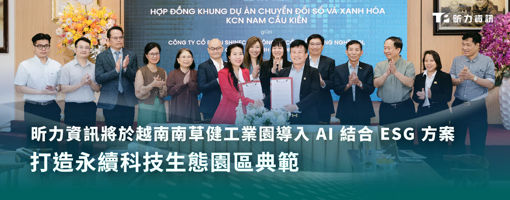

昕力資訊（7781）與越南合作夥伴 ESG 顧問公司 GGI Technology 攜手當地知名生態工業園區南草健（Nam Cau Kien Industrial Park）進行園區全面數位轉型，雙方於 27 日完成簽約後將透過導入結合 AI 的 ESG 產品，共同為工業發展打造智慧永續新模式，進一步強化環境保護（Environmental）、社會責任（Social）及公司治理（Governance），助力越南政府實現 2050 年淨零碳排的目標。

*前排中間為 GGI Technology 執行長 Ms. Nguyen Thuy Anh（左）與 Shinec 董事長 Mr. Pham Hong Diep（右）持合約握手合影。昕力資訊副總經理簡怡雯、越南昕力資訊總經理 Mr. Do Vuong Phong、ESG 專家 Dr. Nguyen Kim Anh，以及 Shinec 高層出席當日簽約儀式。*

**園區導入綠能科技 全面落實低碳永續**

位於北越海防市的南草健為越南首座生態工業園區，自 2008 年創立以來，便以推動永續工業發展為經營理念，吸引了不少國內、外知名大廠進駐，近年與 ESG 顧問公司 GGI Technology 合作，落實園區內的永續管理，而昕力資訊以兩大 ESG 產品—GreenSwift 與 ElectriSwift 全力助攻，從園區內的碳盤查到能源管理，有效檢測碳排並提升能源效率。智慧碳管理平台 GreenSwift 協助企業自動蒐集碳數據，分析後可生成符合國際標準（如：ISO 14064 與 IPCC）的盤查報告，實現高效合規的碳管理策略。智慧能源管理系統 ElectriSwift 能提供即時用電數據，依據環境條件 AI 自動調控空調與燈光，並偵測用電異常，進一步提升 ESG 表現並降低能耗。

**台、越關鍵策略夥伴聯手 共創 ESG 永續新動能**

GGI Technology 執行長 Nguyen Thuy Anh 表示：「GGI 的使命是協助企業邁向綠色轉型，將 ESG 化作企業成長的核心策略，而致力將 ESG 願景與承諾付諸實踐、全力推動越南綠色工業轉型的南草健無疑是最理想的合作夥伴。」

南草健投資方 Shinec 股份公司董事長 Pham Hong Diep 表示：「我們放眼成為綠色工業的新典範，秉持著經濟成長、環境保護與社會責任並重的理念，致力將南草健透過數位科技打造成智慧永續的生態工業園區。海防市是這場永續轉型的起點，未來我們將持續擴展至全國各地，推動永續投資與 ESG 創新，實現綠色發展的長遠願景。」

越南科技翰林院（Vietnam Academy of Science and Technology）ESG 專家 Dr. Nguyen Kim Anh 表示：「真正的綠色工業園區，須結合 ESG 實踐與一體化數位平台，整合環境、能源與生態等關鍵數據。透過 AI 物聯網（AIoT）、人工智慧及遙感探測（Remote Sensing）等技術的應用，實現即時監控與營運優化，進一步推動綠色轉型，打造具韌性與效率的永續工業生態系。」

昕力資訊總經理葉怡蘭表示：「藉著這次落地海外工業園區，昕力資訊也正式對外發表 ElectriSwift，將台灣的綠電節能技術推廣至全球市場，加上近期規劃在台南市政府辦公大樓實行概念驗證（PoC），由此可預見 ElectriSwift 未來導入公部門與商辦大樓的廣泛應用。企業要在技術瓶頸、合規要求與社會責任的多重壓力下維持競爭力，數位轉型與 ESG 實踐的深度融合會是一大關鍵。正如昕力資訊所倡導的理念『Tech for Change』——以科技驅動改變，透過數位創新的綠色科技，協助企業實現 ESG 目標，合力構築綠色永續未來。」
