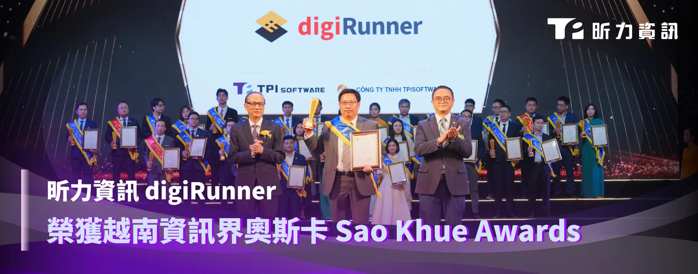

昕力資訊（7781）100%自主研發的企業級 API 管理平台 digiRunner 海外再添得獎佳績，榮獲 2025 年越南軟體與資訊科技大獎 Sao Khue Awards「最佳零售與分銷類解決方案」（Best Solution in Retail & Distribution） 。digiRunner 結合標準化 API 管理機制與微服務架構，支援異質系統整合及第三方服務串接，協助零售業者打造高效安全、可擴充的資訊整合服務中台，促進產業迭代創新。

*越南昕力資訊總經理 Do Vuong Phong （中）出席 Sao Khue Awards 頒獎典禮。*

Sao Khue Awards 由越南軟體和資訊技術服務協會（VINASA）主辦，設立於 2003 年，旨在獎勵軟體資訊界的佼佼者，是越南最具權威的科技大獎之一。今年共有 165 家企業提名逾五百件產品競逐九個獎項類別，由越南前科技部長阮軍（Nguyen Quan）帶領的評審進行三輪嚴格評選，依據市場表現、技術與品質、影響力與成效，以及獨特銷售賣點選出得獎者。今年共有 198 件數位產品、服務與解決方案脫穎而出，而 digiRunner 這次名列零售與分銷類獎項，其建構零售科技生態圈的高效整合與敏捷創新能力深獲評審青睞。

繼去年獲《全球銀行及金融獎》(Global Banking & Finance Awards®) 評選為「2024年南亞洲最佳開放銀行APIs」，昕力再受國際獎項肯定，足見該公司累積 20 年的科技研發實力與創新量能。團隊投入研發的 API 管理平台 digiRunner，不僅適用於零售業的數位挑戰應用情境，更能跨產業滿足數位轉型需求，至今累積實績案例涵蓋金融、保險、醫療、電信、公共服務、製造業、電商等。該平台支援 OAuth 2.0 與 OpenID Connect 驗證機制，遵循歐盟一般資料保護規則（General Data Protection Regulation，GDPR），內建負載平衡與流量控管機制以優化流量分配，確保系統運行穩定不間斷，能有效防止高負載或突發流量所導致的系統異常或癱瘓，是專為關鍵任務應用而生的企業級資訊服務中台。

昕力資訊總經理葉怡蘭表示：「這次得獎不僅是對 digiRunner 在零售業創新應用的高度肯定，也印證了昕力協助企業實現數位轉型、效能極大化，以科技推動創新的卓越成就。相信這項殊榮能為昕力團隊帶來更充沛的動力，持續為各領域客戶打造更完善的資訊服務系統，將昕力在台紮根 20 年的落地經驗推展至越南及其他海外市場，成為國、內外數位轉型的最佳典範。」
