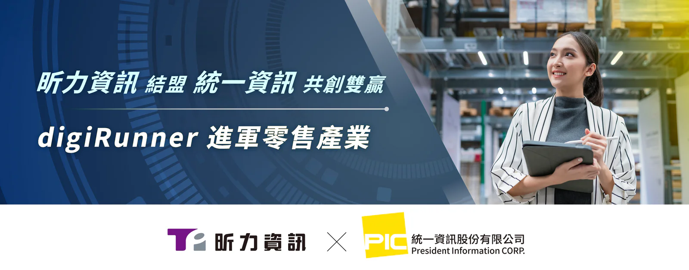

昕力資訊（7781）自主研發的企業級 API 管理平台 digiRunner 獲得台灣零售科技領導品牌統一資訊的肯定，雙方將展開產品策略合作，攜手推動零售產業的數位轉型。隨著零售通路業務型態日益多元，企業面臨來自異質系統整合、第三方服務串接及即時數據交換等挑戰，digiRunner 透過標準化 API 管理機制與彈性部署架構，協助零售業者打造高效、安全且可擴充的資訊整合服務中台，加速數位創新應用落地。

統一資訊將透過 digiRunner 以容器化架構部署零售產業 API 管理中台，打造高度互通的 API 服務平台。 此外，digiRunner API Gateway 提供標準化的 API 管理與安全機制，支援 OAuth 2.0、JWT、API Key 等認證方式，並內建黑白名單控管、異常流量偵測與 API 加密保護，可有效降低 API 介接風險，確保顧客資料與交易資訊的安全性。

統一資訊表示：「零售業 IT 環境面臨來自支付整合、供應鏈數據交換、會員管理與數據分析等挑戰，digiRunner 提供完整 API 管理機制與高度安全控管，不僅能提升內外部系統串接效率，也讓 IT 團隊能夠快速發佈新功能，並符合法規要求。我們期待透過這次合作，加速零售業 API 化的腳步，建立更靈活的數位服務模式。統一資訊也希望透過這次的合作，並憑藉自身在資訊服務市場多年的耕耘，共同向我們的客戶推廣 digiRunner API 管理平台。」

昕力針對大型零售企業在高峰期間（如雙11、周年慶）產生的 API 大量請求，digiRunner 提供智慧負載平衡機制（Load Balancing），能夠根據 API 流量分佈動態調整請求導向，確保系統資源使用最佳化，減少單一服務過載的風險。此外，digiRunner 還具備 流量控制（Traffic Throttling） 機制，可依 API 使用策略設置請求頻率上限，避免突發性異常流量影響系統穩定性，確保企業服務不中斷；同時，透過 API 快取（API Caching），對重複請求提供快速回應，進一步提升系統效能，降低不必要的運算負擔。

昕力資訊總經理葉怡蘭表示：「digiRunner過去在金融產業已有豐富實績，我們很榮幸能與統一資訊合作，為零售業者提供更完善的系統整合方案。面對各行各業人力短缺的趨勢，各產業也越來越重視打造更有效率的資訊系統，簡化各項工作流程，藉由提供方便的工具，達到提昇員工工作效率的目的，昕力也是朝著這個目標協助我們各行各業的客戶，建構完整的資訊服務系統，」葉總經理也提到：「此次與統一資訊的合作，我們相信藉由統一資訊在零售業的經驗與深度，加上昕力的技術能力，為台灣零售產業的 IT 生態立下典範，未來展望統一資訊持續深化與昕力資訊的合作，透，過API管理平台建構更完整的零售科技生態系。未來，雙方將持續深化合作，透過 digiRunner 在 智慧零售（Smart Retail）與全通路整合（Omnichannel Integration） 的應用，強化 API 介接的彈性與效能，共同打造零售數位轉型的新標竿。」
