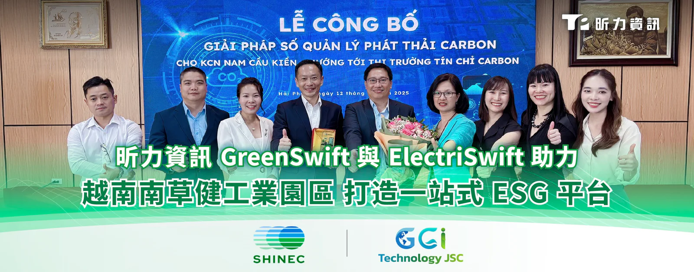
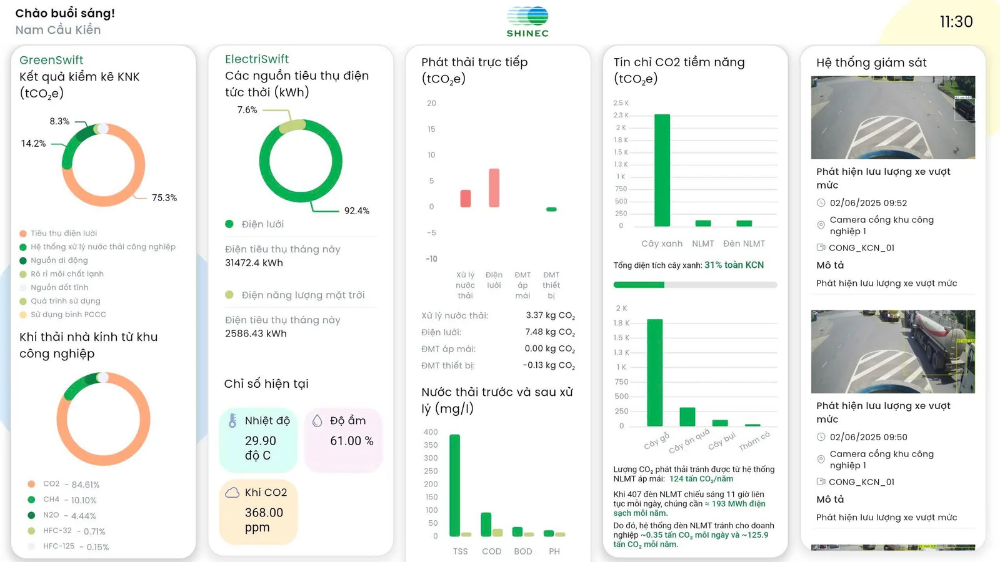

昕力資訊（7781）攜手越南知名工業園區南草健（Nam Cau Kien Industrial Park）與當地 ESG 顧問公司 GGI Technology，推出一站式 ESG 平台「Shinec Digital Green Economy」，結合昕力自主開發的智慧碳管理平台 GreenSwift 與智慧能源管理系統 ElectriSwift，助力越南工業園區數位轉型，實現 2050 淨零碳排目標。

「Shinec Digital Green Economy」平台為昕力資訊、Shinec、GGI Technology 三方共同投入研發的園區智慧管理系統，將碳盤查、能源管理、廢水處理及智慧監控系統全面整合，即時蒐集碳數據，並針對能耗熱點進行分析，將關鍵數據串連至單一介面，提供減碳與節能建議，掌握實際 ESG 成效。

「Shinec Digital Green Economy」結合 GreenSwift，有效蒐集與分析碳排放數據，能快速生成符合 ISO 14064-1 國際標準的報告，提升稽核與盤查效率，搭配 ElectriSwift 即時監控能耗，偵測異常用電，提供數據分析與告警，協助企業優化能源使用策略。另外，該平台也可檢測廢水處理前後的污染源變化，並計算整體碳排放，強化環境合規管理，並利用 AIoT 智慧監控系統，自動偵測人流、火災等異常狀況，即時發出告警，提升園區安全與應變效率。

*圖為「Shinec Digital Green Economy」使用者介面，該平台整合了碳足跡量化、用電數據蒐集、廢水排放參數，以及園區週邊監控影像，以視覺化儀表板呈現關鍵數據，各項指標成效一目了然。*

全球氣候變遷日益加劇，企業面臨綠色供應鏈與國際法規的多重壓力，包括歐盟碳邊境調整機制（CBAM）、IFRS S2 氣候揭露準則，以及企業永續發展報告指令（CSRD）等，如何有效應對規範、實現綠色轉型，成為企業確保營運合規，保持國際競爭力的重大課題。而越南政府為了在2050年前達成淨零排放，也將試行「碳抵換額度交易」，並預計2028年前推出碳權交易平台，供國內外企業進行碳抵換。當地政府也透過優惠措施與培訓計畫支持中小企業逐步導入碳管理系統，降低碳稅風險，同時提升國際競爭力。昕力資訊與越南策略夥伴共同開發的一站式 ESG 平台「Shinec Digital Green Economy」，看準當地後續商機，透過合規、高效管理優化營運、降低成本，以利取得 ISO 50001（能源管理）與 ISO 14068（碳中和）等國際認證，一方面助力南草健工業園區邁向永續發展目標，另一方面也作為越南企業綠色數位解決方案的模範。

昕力資訊總經理葉怡蘭表示：「自去年在越南啟動 GreenSwift 與 ElectriSwift 系統的試行計畫後，今年三月正式導入南草健工業園區，這不僅是台灣智慧綠色科技成功落地海外的典範，更是越南邁向工業數位永續的重要里程碑。未來，我們也將持續與 Shinec 合作，將此綠色轉型模式推廣至旗下六個工業園區，為越南工業永續發展注入更大動能。」
