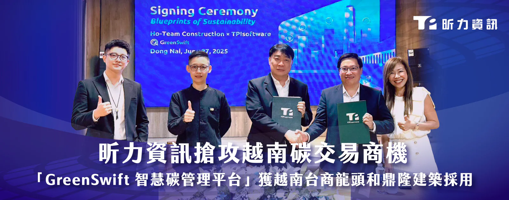
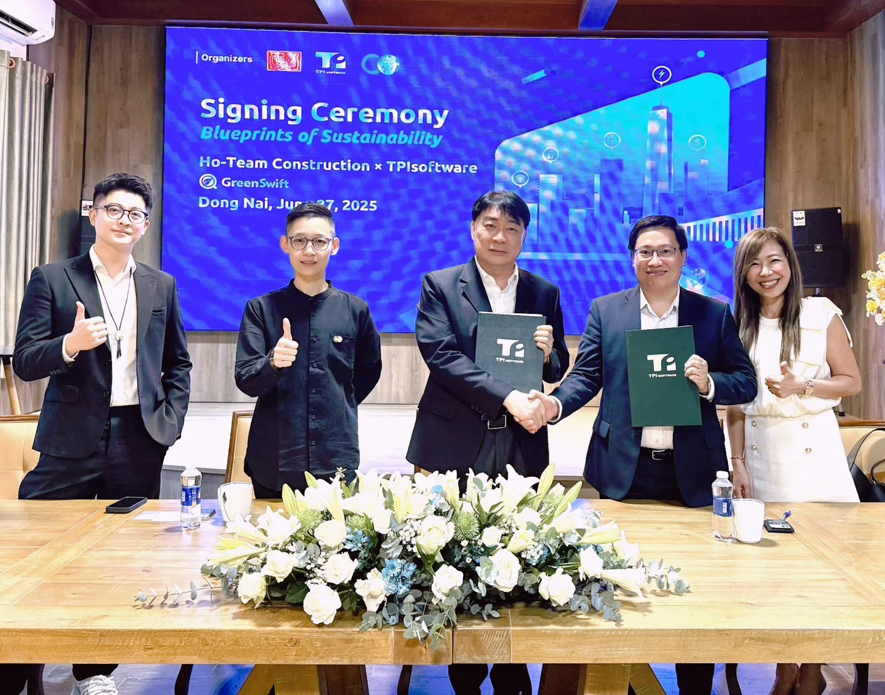

昕力資訊（7781），其自主研發的 AI 智慧碳管理平台 - GreenSwift 正式獲得越南台商營造業龍頭「和鼎隆建築責任有限公司」簽約採用，雙方6月27日於同奈總公司舉辦簽約儀式，成為越南首家導入 AI 智慧碳盤查系統的營造建築企業，協助其一條龍全面數位化碳盤查，強化 ESG 永續競爭力，和鼎隆為越南最大台資營造廠，承攬逾600座廠房與大型工程，近年積極響應越南政府碳交易試點政策，透過導入 GreenSwift，和鼎隆將系統化整合總部碳排放數據，產出符合 ISO 14064 的盤查報告，並串接國際認證碳權，為2029年越南全面碳交易提前佈局。

*和鼎隆董事長簡智明（左）與越南昕力資訊總經理 Mr. Do Vuong Phong（右）持合約握手合影。越南台商碳中和科技聯盟協會監事長呂晉宇、和鼎隆副總經理簡子沄、昕力資訊副總經理簡怡雯一同出席見證簽約儀式。*

當日邀請多位業界代表出席簽約儀式，包含越南碳中和科技聯盟協會、TÜV Rheinland Việt Nam、中鋼中貿金屬（越南）有限公司、大亞電線電纜（越南）、永記造漆（越南）股份有限公司、台芝電氣股份有限公司、台氟科技股份有限公司、士興國際集團等多位重量級嘉賓親臨見證。

**搶攻越南碳交易試點商機，高耗能產業碳管理需求急升**

根據越南政府最新規劃，越南碳排放額度交易試點計畫將於今年正式啟動，首波納入碳排管理的企業約150家，涵蓋鋼鐵、水泥與火力發電等高碳排產業，其中，營造建築業作為高耗能產業，預期將在2029年全面碳交易制度上路時納入管制範圍，和鼎隆建築作為東協一千大台商的營造建築業翹楚，在越南擁有18年深耕經驗，累計承建逾240個工程案，目前擁有13項專案同時進行中（北越6個；南越7個）。面對越南即將實施的碳交易制度，和鼎隆率先導入的 GreenSwift 智慧碳管理平台，結合生成式 AI 技術，協助生成碳盤報告書並取得減碳建議，展現其在永續發展領域的前瞻視野。

昕力 GreenSwift 通過國際查證機構核發 AUP 認證，系統內建最新的碳盤查標準和國際係數，可自由切換使用 ISO 14064 標準，並定期更新 IPCC 的最新係數，可自動計算完整碳排放量，並將碳盤查流程規劃為盤查計畫、組織邊界、排放源鑑別、排放量計算、盤查報告、查證作業等六大步驟，讓企業輕鬆完成碳排放管理，支援跨廠區、多部門雲端協作，特別適合和鼎隆的多點營運模式，不論是在胡志明市、同奈、平陽等地的內外部團隊，都可以共同編輯報告，消除版本不一致困擾。

**深化東南亞布局，打造 ESG 數位生態圈**

和鼎隆董事長簡智明指出：「隨著經濟的發展，越南營建業的碳排放量正逐年增加， 以建材製造業的二氧化碳排放量而言，預計2050年將達到1.48億噸。 越南政府設定了2050年達到淨零碳排的目標，但建築業減碳進展相對緩慢，目前尚未有符合『淨零』排放標準的大樓 ，和鼎隆作為越南營造業的領導企業，深知永續發展的重要性，那就應該由和鼎隆開始做起！」

和鼎隆副總經理，同時也是現任越南台商碳中和科技聯盟協會會長簡子沄，不遺餘力推動越南在地永續發展，他表示：「在全球氣候變遷挑戰日益加劇的今天，實現碳中和已成為各國與企業的共同目標，我們選擇昕力也是對我們『MIT台灣研發』的信心，合作的顧問團隊具備跨國輔導經驗，能同步滿足我們合規需求，加上昕力也在越南建置了完整的經營技術團隊，有足夠的能量與我們攜手在越南打造 ESG 數位生態圈，相信透過數位化碳管理，將有助於海外台商在越南碳交易市場中搶得先機。」

昕力資訊總經理葉怡蘭表示：「此次與和鼎隆的簽約，充分展現了 GreenSwift 在東南亞市場的適用性與競爭力，隨著越南碳交易制度的推進，我們預期將有更多台商企業投入碳管理數位化，昕力資訊將持續深化東南亞市場布局，為台商提供完整的ESG數位轉型解決方案。」
