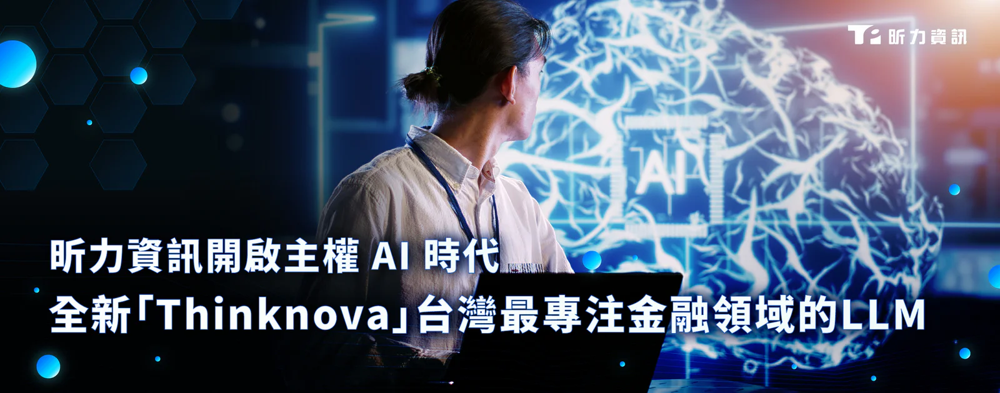

昕力資訊（7781）於今日隆重發表「Thinknova」LLM，經實際驗證具備通過10項金融研訓院的國家金融證照考試的能力，舉凡：初階授信、初階外匯、理財規劃、衍生性金融商品銷售...等，為台灣第一個具備最多張金融證照考試能力的LLM。

隨著生成式 AI 技術蓬勃發展，企業自建大型語言模型（LLM）已成為數位轉型的關鍵戰略，昕力資訊多年來深耕布局 AI 領域，迄今已有超過一億四千萬次的 AI 產品使用人次，其 AI 團隊運用此深厚產業經驗，採用了參數高效微調技術 LoRA（Low-Rank Adaptation），將台灣金融專業知識注入至原始大語言模型中。相較於同等級開源模型於考試中的表現，平均僅落在 50 分上下（滿分 100），顯示大部分開源模型對專業術語、法規與產品邏輯的掌握仍有限，但透過優化資料設計與調控學習策略，Thinknova LLM在相同測試情境中整體成績提升至 90 分上下，展現出高度的知識遷移與推理能力，並成功應對各類型計算題與綜合判斷題。

昕力將以 Thinknova 的技術架構為基礎，推出 SysTalk.Service 為國內企業提供可負擔且高效的自建大語言模型的落地方案，可選用在市面上任何一種 AI 開源模型為其基礎，運用 AI Fine-tune 技術，真正做到企業 AI 自主。

**致力 AI 技術整合突破 以SysTalk.Service打造企業專屬LLM**

昕力資訊創新暨 AI 產品發展處副總經理林秀明表示：「昕力運用的 Fine-tune 技術，簡單來說，就是利用生成式 AI 博學通才的特性，透過昕力 AI 團隊在特定領域再訓練，進而成為該領域裡的專才；這就像大家常使用的 ChatGPT 這類模型，雖然具備一定的對話、理解、推理能力，但是對企業來說，特別是金融、醫療業，就會需要更專精領域的專業知識，以回覆提問者的諮詢。」

Thinknova 的成功，表示企業未來在導入 AI 大語言模型之際，能降低機敏資料外洩的疑慮。昕力期望透過SysTalk.Service降低 AI 導入門檻，讓更多台灣企業能夠擁有自己的 AI 專家助手，不僅能提升整體產業競爭力，更能在全球 AI 浪潮中，建立屬於台灣的 AI 生態系。

**將技術優勢轉化為公司成長動能**

昕力資訊不只是在AI相關技術做出突破，2025 上半年公告累積營收更是較去年同期年增17.5%。儘管全球經濟環境充滿變數，昕力資訊憑藉其核心軟體技術穩定部署，持續受益於生成式AI與企業數位轉型需求的強勁增長。

展望未來，昕力資訊總經理葉怡蘭表示，隨著主流 AI 市場快速擴張，公司採取「先蹲後跳」的策略，除了先穩固國內市場，跨足醫療、製造業，海外則優先深耕東南亞，繼年初完成越南子公司併購，後續又成功導入「Shinec Digital Green Economy」平台，協助南草健工業園區實現數位永續轉型，持續以領先的技術研發實力與前瞻性產品策略，靈活應對市場動態，加速全球市場布局，搶占 AI 與數位轉型先機，推動營收動能與品牌影響力，鞏固在全球軟體產業的競爭優勢。
