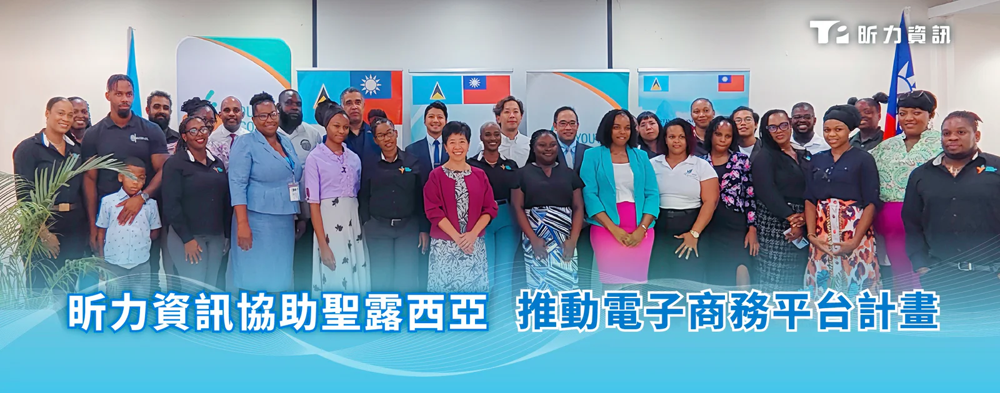

昕力資訊（證券櫃檯買賣中心股票代號：7781）攜手財團法人國際合作發展基金會（國合會）與聖露西亞青年經濟局（YEA），共同正式啟動「YEA電子商務平台」，協助當地青年與婦女開拓數位市場、提升創業能量。啟動儀式由我國駐聖露西亞大使蘇瑩君、YEA執行長Bryan Vidal、董事會主席Thomas Leonce、國合會駐聖露西亞技術團團長李宜龍，以及昕力資訊副總經理巫右棋共同出席。

YEA平台的啟動是昕力資訊國際化布局的重要里程碑，不僅提升當地微型與中小企業的市場能見度與競爭力，更結合國合會「青年及婦女賦權計畫」，已支持超過525名青年與婦女接受創業訓練，幫助640家企業獲得商業諮詢。昕力資訊以技術賦能，加速聖露西亞創業者的數位轉型與成長，未來將深化全球合作，導入AI Agent技術與資安機制，確保資料安全與業務連續性，推動客戶成功轉型，鞏固市場領導地位。

蘇瑩君表示，電子商務是當今消費模式轉變下的重要趨勢，此平台的啟用象徵聖露西亞青年與婦女邁入數位經濟的關鍵一步，我們樂於分享「台灣經驗」數位經驗與實力，協助當地創業者拓展本地、區域乃至國際市場。

昕力資訊憑藉領先的AI與數位解決方案打造YEA電子商務平台，提供高效能數位營運體驗。平台支援即時下單、訂單與庫存管理，整合數據分析與市場洞察功能，有效降低創業門檻，賦能青年與婦女企業主參與全球市場競爭。昕力資訊總經理葉怡蘭強調，平台以昕力資訊核心技術為基礎，實現流程自動化與智慧化管理。未來將新增訪客購物、賣家後台、顧客評價與先進訂單追蹤功能，並導入安全線上支付系統，打造完善數位商務生態。
