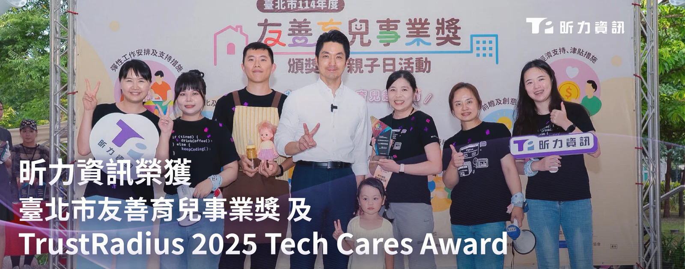

**友善、多元、永續實踐成果豐碩**

昕力資訊（7781）長期推動ESG與DEI實績有成，近期獲得「臺北市友善育兒事業獎」及國際軟體評論網站「TrustRadius 2025 Tech Cares Award」兩項殊榮，充分展現昕力落實企業社會責任（CSR）的承諾，從組織內部推行育兒友善措施、員工關懷方案，到重視環境永續發展的環保行動，致力將「多元、友善、永續」的目標付諸實行。

對於國內外接連獲獎，昕力資訊總經理葉怡蘭表示：「昕力貫徹以人為本的企業文化，將多元（Diversity）、平等（Equity）與共融（Inclusion）植入組織DNA。去年獲得『TCSA 台灣企業永續獎—性別平等領袖獎』、『104人力銀行2024雇主品牌大賞—最佳吸引力獎』與『Yourator 雇主品牌大賞—優秀企業獎』，顯示我們持續推動性平與友善職場文化的成果備受肯定。昕力的理念從不侷限於在組織內帶來改變，更把顧及所有利害關係人視為己身大任，積極響應政府推動永續發展目標（SDGs）的號召，透過四大產品線與AI技術協助企業打造永續競爭力，向台灣乃至世界展示昕力如何實踐永續經營，帶動正向影響力的循環。」

**昕力獲頒「績優事業」 齊力推動友善育兒職場文化**

昕力日前獲頒「臺北市政府勞動局114年度友善育兒事業獎」，與44家職場友善企業名列「績優事業」。該獎評選過程共分三個階段，從七大面向進行綜合評核，包含：組織文化政策項目、彈性工作安排及支持措施項目、育兒支持假別措施項目、職場直接設置托兒服務項目、育兒與親職支持網絡與措施項目、經濟支持津貼措施項目，以及前瞻及創意作為。昕力一向積極推行「友善安家」相關政策與福利，旨在給予新手父母最完善且實際的支持。除了一般企業常見的彈性工時、遠端辦公政策，昕力也提供優於法規的十天產檢假、育兒津貼、親職教育學習平台、新生兒祝福禮等，讓員工能安心生養；更在辦公室設置臨時托育空間、哺集乳室，幫助同仁減輕育兒壓力，在人生不同階段皆能取得工作與家庭間的平衡，提升職場幸福感。

**獲選 TrustRadius 全球百家DEI友善軟體公司 永續行動受國際表彰**

在育兒友善方面獲臺北市政府表彰之外，昕力今年在國際評選中亦大有斬獲，榮獲知名軟體評論網站 TrustRadius 2025 Tech Cares Award 肯定，與全球100家科技業者齊名，在「環境永續、DEI 多元共融、員工身心健康與發展、支持科技業女性、教育支持」五個面向展現永續實績與影響力。昕力作為台灣少數具備自主研發量能的軟體公司，以自身科技實力推出智慧碳管理平台與能源管理系統，協助企業達成ESG指標。去年更加入綠色企業行列，參與「台電小額綠電銷售計畫」競價得標，2025至2029年將在高雄辦公室導入一萬度綠電。而在組織內部，昕力推出員工協助方案（EAP），公司同仁可享有每年三次的免費心理諮商服務，另有高規格健檢、舒壓按摩、學費與進修補助、生日假等，為全體員工提供全方位照顧與福利。

昕力資訊副總經理葉淑婷表示：「昕力扁平化的組織架構讓同仁間能打破職級的藩籬，達成雙向平等的溝通，提升員工參與度與歸屬感。除了致力打造幸福職場，我們今年也投入多項永續行動，如：響應『舊鞋救命』活動，募集上百雙鞋子送往東非偏鄉、舉辦內部二手拍賣活動等，4月亦如期完成植樹計畫，在台東種下原生種樹苗。我們始終堅信，企業的成功不僅反映在營利，更在對人與環境的貢獻及關懷，創造永續價值，一齊茁壯、共榮共好。」
