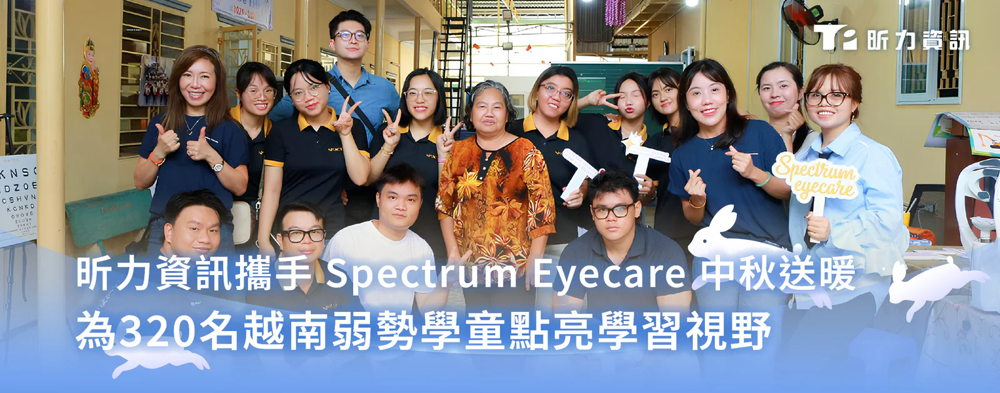

昕力資訊與 Spectrum Eyecare 積極投身慈善公益，於中秋佳節前夕走訪三家慈善機構，為 320 名學童免費檢測視力及配眼鏡，並分送月餅禮盒與學習用品，以實際行動支持當地社群，讓弱勢學童也能感受到節慶祝福與社會關懷。

*福善寺愛心班學童參與團隊主辦之活動。*

此次公益活動呼應主題「呵護雙眼，點亮未來」（Care for Your Eyes, Shine for Your Future），由昕力資訊協同 Spectrum Eyecare 專業驗光團隊走訪越南平壽中心（Bình Thọ Centre）、祈光寺（Kỳ Quang Pagoda）與福善寺愛心班（Phước Thiện Pagoda Volunteer Class），透過提供細緻的驗光及配鏡服務，讓學童擁有好視力，能在學習上保持專注且良好的閱讀。

Spectrum Eyecare 發言人 Catherine Tran 表示：「秉持『See Clear, Give Back』的信念，我們認為清晰的視力是所有人的基本權利，更是每個孩子成長與學習的重要基石。這次與理念一致、致力落實社會責任的昕力資訊合作，讓我們能在中秋前夕幫助到更多弱勢學童。」

昕力資訊總經理葉怡蘭表示：「昕力資訊秉持以人為本的精神，將品牌價值『Tech for Change』的理念付諸行動。作為一家軟體開發商，我們不僅致力於為企業打造系統解決方案，更深信企業的價值應與社會共好緊密連結，以實際行動積極回饋需要幫助的群體。此次透過與 Spectrum Eyecare 的跨界合作，我們有幸能為越南弱勢學童帶來實質幫助，深知教育是翻轉孩子未來的力量，而良好的視力則是學習的第一步，我們期許透過這次行動，為孩子們開啟更寬廣的學習視野，也期待能拋磚引玉，號召更多企業夥伴一同投入公益，共同為下一代創造更美好的未來。」
