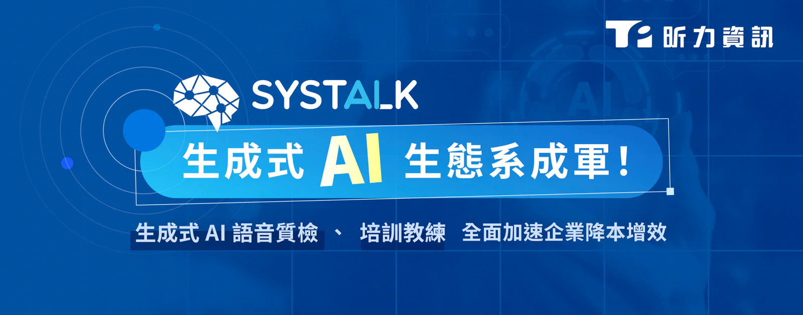

[昕力資訊](/)（7781）今日正式發表兩項生成式 AI 產品 SysTalk.Audit 與 SysTalk.Coach，聚焦企業客服以及教育訓練兩大場域，以生成式AI協助企業提升服務品質、強化人才培訓效率，打造以 AI 為核心的 7x24 智慧營運模式。此次發表，也體現了昕力資訊以生態系思維構築企業 AI 版圖的策略，結合先前上市的[新一代 AI 光學字元辨識 SysTalk.ICR](/products/systalk-icr) 以及[企業生成式 AI 平台 SysTalk.VIKI](/products/systalk-viki)，各產品不僅能獨立運作，更能形成相互連結的整合生態，輔以新型專利，全面提供企業 Agentic AI（代理式 AI）解決方案。

**SysTalk.Audit：以生成式 AI 進行全方位 100% 通話質檢「台語嘛會通」**

人工質檢使用抽檢、舊式語音質檢仰賴預設規則，一旦互動內容脫離特定關鍵字就易出現誤判、漏判情形，皆難以有效優化客服品質。SysTalk.Audit 以生成式 AI 為核心，具備自然語言理解能力，精準解析語意與情緒，支援國、台、客、英等多語種對話，自動將語音轉寫成文字，並依上下文分析意圖與情緒。企業主管無需熟悉 AI，即可運用生成式 AI 的優勢自訂評分邏輯與權重，系統亦會自動生成摘要與改善建議，確保每次互動符合標準，持續提升顧客體驗。

**SysTalk.Coach：7x24 個人化 AI 專業陪練，人性化打造頂尖服務團隊**

傳統「老手帶新手」培訓耗時且成效難以量化。SysTalk.Coach 模擬各類客戶互動情境，提供即時回饋與實戰練習，幫助新進人員快速掌握溝通技巧、說服策略與產品知識。企業主管無需熟悉生成式 AI 的的提示工程（Prompting Engineering）即可設定任務或檢核點，透過 AI 數據追蹤團隊表現，並利用高質量語料優化模型，讓培訓流程自動升級，縮短學習曲線並降低成本，實現人才快速成長與知識無縫傳承。

昕力資訊創新暨 AI 產品發展處副總經理林秀明表示：「儘管 AI 工具採用率持續攀升，台灣多數企業仍未能獲得實質商業回報，根據 [MIT 研究報告](https://mlq.ai/media/quarterly_decks/v0.1_State_of_AI_in_Business_2025_Report.pdf) 指出，僅 5% 企業成功創造了數百萬美元的價值，以失敗告終的專案更不在少數，主因在於企業誤將 AI 個人應用與企業應用畫上等號，期待一套 AI 工具能完成所有任務，這樣的思維讓 AI 應用難以落地。昕力運用生成式 AI 實現新一代的金融科技與監理科技，以生態系的概念，從客戶的角度出發，開發真正符合企業需求的 AI 產品，將 AI 技術轉化為實際的創新應用。」

昕力資訊總經理葉怡蘭表示：「AI 轉型不止是技術問題，更是策略問題。企業需要的不只是 AI 工具，更需要一個既懂技術、又熟悉產業生態的強力夥伴。昕力的強項不止於軟體技術，我們專注企業實際痛點，從繁瑣、重複的工作流程切入，透過專才團隊提供的 SysTalk.Service 轉化為可落地的創新應用，真正提升企業服務品質與營運效率，運用『對的 AI』為企業帶來高效益、高價值的應用。」
