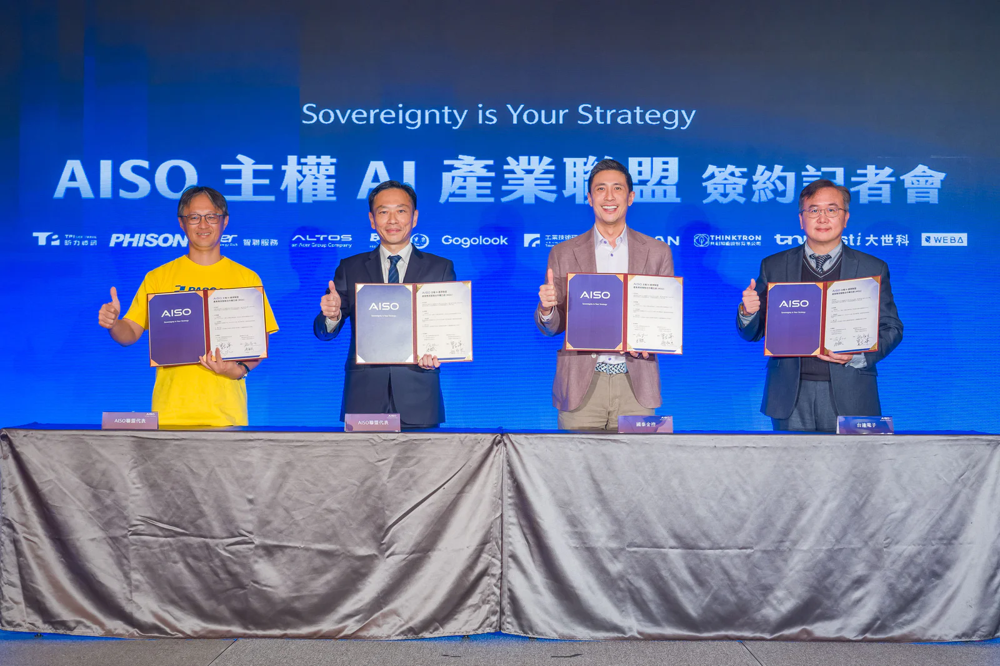

*群聯電子執行長潘健成、數位發展部數位產業署簡任視察許美玲、國家發展委員會產業發展處參事林青嶔、昕力資訊董事長姚勝富啟動 AISO 聯盟正式成立。*

2026 年被視為全球「主權 AI 元年」，昕力資訊（櫃買中心股票代號：7781）23 日舉行 <strong>[AISO 主權 AI 產業聯盟](https://aisoportal.com/)</strong>簽署儀式，宣布攜手群聯電子，集結包含 Gogolook、凱鈿、台灣銘板、大同世界科技、安圖斯、興創知能、景宜、智聯服務、精英電腦、豐康科技等 12 間國內知名軟硬體夥伴，與指導單位工研院共同展開策略合作。特別的是，國泰金控與台達電子兩家重量級企業當場與聯盟完成簽約，現場亦有數發部、國發會等官員見證。

AISO 聯盟主打 AI 軟硬體整合式方案、整機交付的商業模式切入企業需求，降低企業在成本與維運上的門檻，推動主權 AI 方案更快進入規模化應用，並以拓展海外市場為方向，聯盟不只著眼於這塊市場遠景，而是打造一套「AISO Inside」的台灣標準，能確保 100% 地端部署與物理隔離，完全符合歐盟 AI 法案與台灣資安規範。業界認為， AISO 聯盟以平台、營運商、成員三方協作的模式，可解決企業導入 AI 最棘手的「最後一哩路」工程，一站式的服務，也能打破導入 AI 時的多頭馬車困境。

昕力資訊董事長姚勝富指出，企業AI應用的關鍵瓶頸在於「企業端導入」，市場不缺 AI 技術，真正困難的是將 AI 能力對接到企業實際流程，同時兼顧資料治理與資安合規要求，為加速企業端應用落地，公司因此整合多家產業夥伴共同成立 AISO 聯盟，建立軟硬整合平台，以完整生態系，滿足金融、醫療、公部門等高價值產業之需求。

群聯執行長潘健成認為，企業評估導入 AI 時，會先思考到資金門檻、硬體規格、基建維護負擔， AISO 聯盟以客製化、整機交付的模式商轉，並結合群聯 aiDAPTIV 等技術與軟體夥伴能力，協助企業在高合規前提下加快部署節奏，降低導入過程的摩擦，達成交機即用的目標。

*群聯電子執行長潘健成、昕力資訊董事長姚勝富、國泰金控科技長姚旭杰與台達電資訊長曾立峰簽署 MOU。*

活動現場，兩大台灣代表性企業——國泰金控與台達電子，也與 AISO 聯盟正式完成策略簽約儀式，象徵「主權 AI」已從技術開發正式邁入大規模產業實作階段。國泰金控科技長姚旭杰表示，「Cloud-first」雖是國泰數位轉型的核心策略，但針對高度敏感資料仍需地端方案，若輔以 AISO 內建之 AI 治理軟體，能確保數據不出境並符合國內相關 AI 治理規範 ，在落實數位主權的同時，大幅降低系統落地成本。

台達電資訊長曾立峰說明，群聯 aiDAPTIV 技術結合昕力軟體內建的一體機方案，讓企業在相同預算下，同時擁有高效能系統與 AI 應用軟體，可透過「AISO Inside」模式實現 100% 自主管理 ，加速落實 AI 智慧化轉型 。

姚勝富透露後續將優先深入高監管產業市場，透過可複製的整合架構與交付流程擴大導入範圍，並逐步擴充生態系合作與在地交付能量。他強調主權 AI 需求不僅限於台灣市場，全球企業對此均有高度需求，昕力資訊將以 AISO 聯盟作為對外拓展的平台，結合夥伴通路與在地交付能力，推進海外市場布局。
