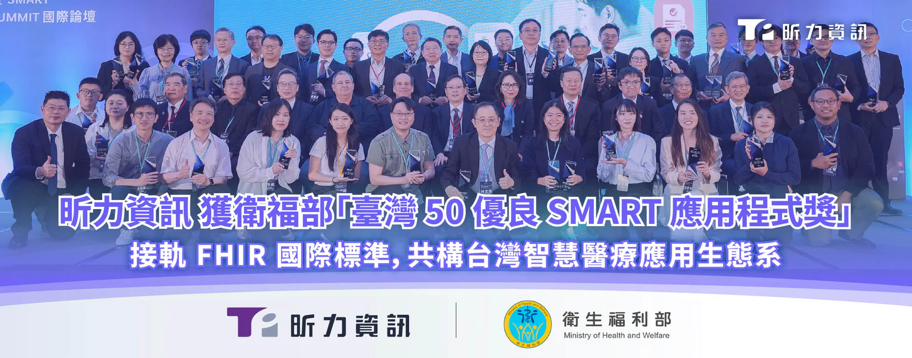

數位轉型領導廠商[**昕力資訊**](/)（7781）日前獲衛福部肯定，從上百件智慧醫療解決方案中脫穎而出，獲選為第一屆「[**臺灣 50 優良 SMART 應用程式：醫學 AI 類**](https://www.mohw.gov.tw/cp-7398-86093-1.html)」優質應用。衛福部 2025 年起推動 SMART on FHIR 標準化架構，旨在促進跨院、跨系統的醫療資訊互通整合，實現「統一資料、規則、應用程式」三大目標，今年首度舉辦優良 App 公開徵選，讓全國頂尖醫療院所與軟體業者同台競逐，以獎勵創新提案。

今年獲表揚的 50 組具代表性之解決方案中，類別涵蓋醫學人工智慧（AI）、醫療營運管理、臨床決策支援及資料視覺化等多元應用場景，通過驗測的徵案將上架 SMART 應用程式市集（THAS）直接供醫療機構選用。昕力以自主研發的智慧醫療解決方案 [**digiCare**](/products/digicare) 之關鍵應用模組——「醫點就通」PCS 編碼智慧小助手參加徵選，並通過衛福部與工研院建置的雙層沙盒機制，臨床實證 100% 符合 SMART on FHIR 國際標準，入選醫學 AI 類優質應用。

*健保署陳亮妤署長（左）頒發獎座予昕力資訊企業應用產品發展處研發部長陳瑞泰。*

**解決放射科人工編碼痛點，優化醫療行政作業**

傳統放射科影像報告的 ICD-10-PCS 編碼流程極為繁瑣，實務上仰賴編碼人員肉眼判讀非結構化資料中的多軸向七位代碼，並且需在不同系統間來回切換，增加行政負擔與出錯率，也導致健保申報的核刪風險。

昕力開發的智慧編碼工具，結合 AI 推論引擎，遵循國際通用醫療影像標準 DICOM，以自然語言處理（NLP）技術自動識別報告中顯影劑、解剖部位等欄位資訊，由 AI 執行編碼作業，供醫事人員直接審核，同時整合電子病歷（EHR）、HIS 等資訊系統，免除人工重複輸入病患個資，不僅減輕醫事人員作業壓力，亦能優化編碼流程，降低出錯率及送審遭核刪的風險。

昕力資訊企業應用產品發展處副總經理夏宏彰表示：「昕力深耕金融業多年，累積紮實能力與落地經驗，在醫療領域的經營成果可謂後發先至，今年入選首波 50 優良 SMART on FHIR App，展現昕力在醫療資訊應用的研發量能。未來醫療資訊應用程式可如手機 App 一般『即插即用』，大幅降低介接門檻與投入成本，加速各級醫療機構導入臨床應用，打破醫療體系長期以來數據各自為政的困境，帶動診療效率與品質提升。」

昕力資訊總經理葉怡蘭表示：「面對全球智慧醫療發展趨勢，昕力的角色一直都是醫療院所數位轉型的協力夥伴，透過產、官、學、醫界聯手打造符合 TW Core 與 FHIR 規範的醫療解決方案，推動 AI 落地應用，實現更精準、高效的臨床決策，讓醫護人員能將寶貴時間用於病患照護與診治，提供以病人為中心的醫療服務，同時推動健康數據的互通共享，建立標準化、開放且安全的醫療應用生態系，仿效美國全基因體數據庫計畫 All of Us，建構屬於台灣的國家級醫療資料研究資料庫。」
