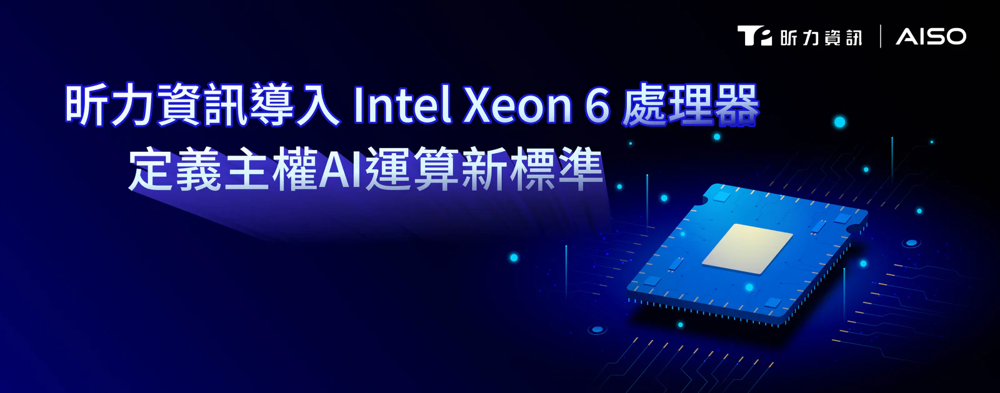

隨著企業對資料自主與在地部署需求提升，「主權 AI」與軟硬整合架構正成為下一波關鍵競爭力，**[昕力資訊](/)**（7781）今宣布正式導入具備 Performance Cores（P-Cores） 的 Intel Xeon 6 處理器與 Intel Arc Pro B60 GPU，作為其企業級 AI 解決方案的核心運算底層，這不僅是昕力在軟硬整合上的重大技術突破，也正式宣布成為英特爾夥伴聯盟 Intel Partner Alliance 的一員，企盼透過與 Intel 的深度合作，強化昕力在邊緣運算與生成式 AI 領域的技術能力，協助企業加速數位轉型，並提升關鍵任務應用的穩定性與效能表現。

針對企業導入生成式 AI 時面臨的成本與數據控制挑戰，以昕力自研的 SysTalk.VIKI 平台搭載 Intel 架構為例，Intel Xeon 6 處理器提供強大的運算核心，為複雜的企業級 AI 模型提供穩定且高效的運算基礎 ，在​​結合 Intel Arc Pro GPU，SysTalk.VIKI 在初步測試中展現出優異的推論效能與低延遲特性，特別能支撐高併發的企業應用場景，透過這套軟硬一體架構，企業能實現全面性的地端部署，確保敏感數據在資安與合規的前提下，落實在地化管理 。

昕力資訊董事長姚勝富表示：「昕力深耕高監管產業多年，我們深知維持系統高度穩定與效能，是企業邁向成功的核心標準，此次導入 Intel Xeon 6 與 Intel Arc Pro B60，不僅是昕力深化技術佈局的展現，更是我們推動『AISO 主權 AI 軟硬整合生態系』的重要里程碑 ，藉由 Intel 在全球領先的技術優勢，我們將能進一步整合自研的生成式 AI 平台、API 管理中台與 AI Gateway 能力，為企業打造兼具『在地部署、資料自主與高效能運算』的解決方案 ，這確保企業敏感數據能 100% 落實在地化管理，在安全、合規的前提下，實現百工百業的智慧化轉型。」

Intel 亞太及日本區副總裁暨總經理 Santhosh Viswanathan 表示：「隨著亞太及日本地區的企業競相解鎖 AI 價值，他們需要在具備可擴充性的單一架構下，尋求效能、經濟效益及數據管控三者兼備的平台。透過結合 Intel Xeon 6 處理器與 Intel Arc Pro GPU，像昕力 SysTalk.VIKI 這樣的應用平台，將能為客戶提供強大的地端生成式 AI 架構基礎，不僅有助降低成本、提升回應速度，更能保有對機敏數據的主權掌控。這正是 Intel 與各區域合作夥伴共同打造的企業級主權 AI，讓各國政府與企業在加速推動 AI 的同時，無需在合規性、安全性或信任上做出妥協。」

昕力資訊將透過新加坡、越南與日本等據點的布局，加速拓展亞太市場，推動企業 AI 解決方案的國際化發展。

©Intel, the Intel logo and other Intel marks are trademarks of Intel Corporation or its subsidiaries.
