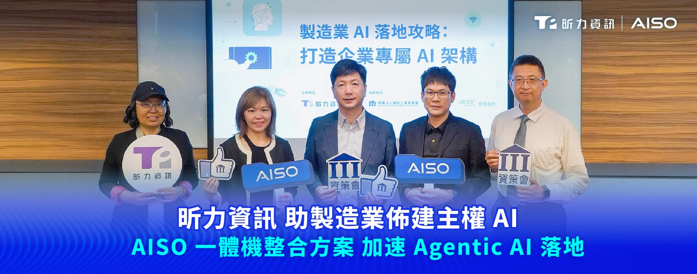
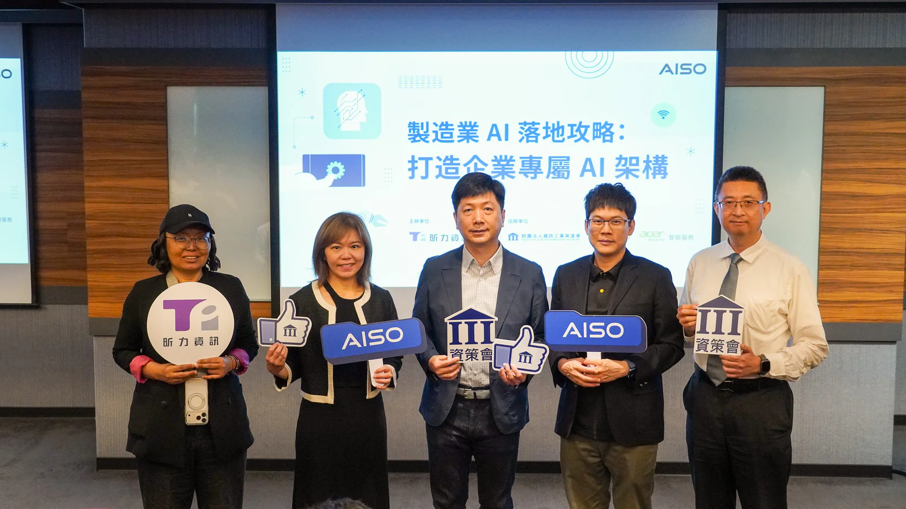

**[昕力資訊](/)**（7781）於 6 月 23 日協同資策會、群聯電子與智聯服務舉辦<strong>《製造業 AI 落地攻略：打造企業專屬 AI 架構》研討會</strong>，聚焦製造業地端 AI 部署策略，實現合規治理與創新應用，為有意導入 Agentic AI 應用的組織提供可行的落地路徑。

*由左至右依序為：昕力資訊高級售前規劃賴欣怡總監、昕力資訊總經理葉怡蘭、資策會 AI 院智慧應用基盤中心蔡德祿主任、群聯電子 AI 事業開發部蔡宗勲協理、資策會產研所軟體產業研究中心朱師右組長。*

企業積極擴大 Agentic AI 佈局，台灣製造業仍在 AI 轉型上面臨卡關，**昕力資訊總經理葉怡蘭**指出，並非業者對 AI 認知不足或不想導入，而是資料長期被困在設備端，加上工作流程尚未全面數位化，關鍵數據仍未 AI-Ready，導致 AI 應用無法深入日常營運，數據缺口直接限制 AI 的落地深度，也決定企業能否跨越 PoC 階段，邁向規模化落地，創造可量化的 AI ROI。隨著 AI 技術快速演進，成本與資安議題相繼浮上檯面，葉總經理表示，主權 AI 的核心在於模型在地化與算力自主化，由此實現可信任、安全可控的代理式應用，滿足日益嚴格的監管需求。

隨著 AI Agent 從內容生成走向任務規劃、工具調用與跨系統執行，其行動自主性與系統連動性持續提升，也使錯誤不可預測性、權限濫用與資安風險同步擴大。**資策會產研所軟體產業研究中心朱師右組長**表示，AI風險已不再只是模型輸出錯誤，而是延伸至資料存取、身分權限、流程控管、第三方工具、供應鏈依賴與資安治理等層面；若企業未能及早建立完整治理機制，AI 將可能成為企業重要的系統性風險來源之一。朱組長進一步指出，缺乏完善AI治理框架，模型、資料、人員、工具與流程之間容易形成風險連鎖反應，進而提高 AI 進入生產環境與規模化落地的難度。企業唯有建立可控、可信、可解釋、可監控、可稽核的治理基礎，才能讓 AI 從局部試點走向安全、穩定且具長期價值的企業級應用。此外，全球AI競爭正從模型能力競賽，逐步邁向算力與推論經濟階段。朱組長也指出，AI賽道上的決勝關鍵，正從單一模型表現，轉向使用量、流量入口、開發者生態、推論效率與算力變現能力的綜合競爭；Token 處理量也將成為觀察AI使用規模、平台滲透率與推論經濟化程度的重要指標之一，但仍須搭配可靠性、成本、治理、資安與商業價值等面向，才能完整評估AI產業成熟度。

針對製造業 AI 導入困境，**資策會 AI 院智慧應用基盤中心蔡德祿主任**以實際輔導經驗提出建議，在既有的數位基礎上導入 AI 應用，可望降低技術與資源門檻，亦有助提升製造業 AI 普及率。據他觀察，製造業導入 Agentic AI 仍卡關，成因來自系統、知識與信任三大斷層，資料相當分散也尚未結構化，導致數據孤島，並且 AI 帶來的資安疑慮仍待解決，使其無法在稽核與品管單位擴大應用。在實務案例上，蔡主任以 Agentic Manufacturing System（AMS）架構提出三種核心 Agents：Connection Agent（打破資訊孤島）、Knowledge Agent（萃取領域知識）與 Trust Agent（確保安全合規），成功協助企業開發出七種應用場域的 Agent，並將持續複製到電子、半導體、紡織等產業。

**群聯電子 AI 事業開發部蔡宗勲協理**指出，據推估，導入 AI 成本與缺工損失在第 9 個月出現黃金交叉——缺工累計損失將超越 AI 投入成本。換言之，時間越往後，AI 越能弭平缺工造成的損失，這對缺工比例居全國之冠的製造業來說，AI 可以是解決勞動力瓶頸的解方；例如，基於群聯 aiDAPTIV 方案，導入智慧圖紙報價，能協助業務與工程人員快速判讀圖面、估算成本並縮短報價週期；導入智慧品管報告產生，則可自動彙整檢測數據、生成異常分析與改善建議，降低高度仰賴人工作業所造成的時間耗損與判讀落差，讓 AI 更具體回應製造現場的人力缺口與效率挑戰。透過打造地端算力中心，掌握自有算力，AI 能協助製造業真正降本增效。群聯電子 aiDAPTIV+ 技術可輕鬆部署在終端邊緣裝置（如：Notebook、Workstation）擴充記憶體容量，以更低的成本、更少的運算資源與更低的功耗進行推論，回應速度提升數倍以上，突破既有算力限制，大幅降低延遲，同時確保資料留在地端，符合隱私並實現資料主權。

AI 運算需求激增，資料主權與治理挑戰隨之浮現，**昕力資訊高級售前規劃賴欣怡總監**表示，企業亟需全面性的治理框架，以應對算力成本與合規壓力。透過昕力開發的企業級 Agentic AI 平台「**[OrientAI](/orient-ai)**」，模型運算與資料處理全程不離廠，實現 100% 物理隔離，結合角色權限管理（RBAC）與 Token 控管機制，防止機敏資料外洩與 Token 用量失控，確保安全、可控的 Agentic 應用。AI 時代下的競爭優勢，將取決於 AI 投資成效可否被實質衡量。可觀測性與成本透明化提供了算力優化的真實依據，揭露 AI 運算的總持有成本（TCO），而非只讓企業看到 GPU 採購單價。
