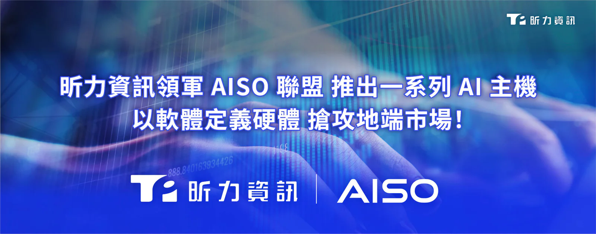

企業在成本攀升與監管壓力的挑戰下，無不尋求更符合投資效益、合規安全的自主化地端 AI 架構，以滿足 AI 治理及底層算力的剛需。**[昕力資訊](/)**（7781）領軍 AISO 聯盟，正式上架預先整合的「AI 筆電」與全系列軟硬整合一體機方案，從行動 AI 筆電、產業專用機到自營品牌「AISO 1」，此系列方案以昕力自主研發的<strong>[企業級 Agentic AI 平台 OrientAI](/orient-ai)</strong> 為軟體核心，提供使用者「開箱即用」、「隨身攜帶」、具備高算力與數據安全的「行動 AI 指揮中心」。

**應用先行！OrientAI 打造可控制、可信任的 AI 員工作業生態**

市場上的傳統 AI 筆電或硬體多半僅提供終端算力，缺乏企業級的管理與防護機制，所以配備適用的 AI 管理軟體才是使用者每日的運作核心，此次昕力推出的 AISO AI 一體機可選擇搭載 OrientAI 平台，提供企業雲地兼顧的集中化管理介面，使用者可依任務敏感度彈性調度，涉及機密數據的工作留在地端處理，一般任務則交由雲端，加上OrientAI 也具有設定 Token 用量上限的功能，並可透過管理儀表板即時檢視，避免濫用與預算失控，兼具數據安全與營運成本。同時，OrientAI 建立標準化的 AI Agent 管理機制，讓 AI 員工的存取權限嚴格綁定使用者身分與管理者授權，確保 AI 運作不越界、權限可追溯，實現安全可控的企業級 AI 治理。

**AISO 聯盟生態系成形，預告十月開賣首款品牌機「AISO 1」**

AISO 聯盟不只提供單一硬體，更以「軟體定義硬體」的策略，主打垂直產業應用一體機，展現聯盟生態系多元發展的成熟實力，除了以 AI NB 外，亦同步串聯昕力旗艦級「digiCare 智慧醫療一體機」，與聯盟夥伴凱鈿的「醫療/製造智慧文件一體機」，實現跨產業的多元落地。此外，聯盟更預告將於十月中旬推出首款自營品牌「AISO 1」地端 AI Agent 機，把大型 MoE 模型、私有知識庫與 AI Agent 電腦自動化工作流濃縮至桌面主機。無論何種型態，皆由 OrientAI 進行統一治理與 Token 成本精算，為百工百業提供「算力吃到飽、數據不出門」的完整主權 AI 戰略應用！

昕力資訊總經理葉怡蘭表示：「隨著『AISO 主權 AI 產業聯盟』第二波成員加入，AISO 生態圈日漸擴大，我們以 AI 筆電作為行動場域的先鋒，後續還有多種一體機方案可滿足醫療、製造、金融、國防、政府單位等應用，客戶可依團隊規模與需求直接在 **[AISO Portal](https://aisoportal.com/)** 訂購 AI Notebook、AI PC、Workstation、Server 等硬體設備，享有一站式服務的便利，省去詢議價、相容驗證等流程，開箱即可部署；近期昕力也陸續獲得多家國際AI大廠青睞，持續以 AI Partner 的角色，將台灣卓越的 AI 實力推向亞太與全球市場。」

AISO 一體化整合方案，可大幅縮短企業採購流程、降低 AI 導入門檻，了解更多一體機方案請前往 AISO 官網：**[https://aisoportal.com](https://aisoportal.com/)**
