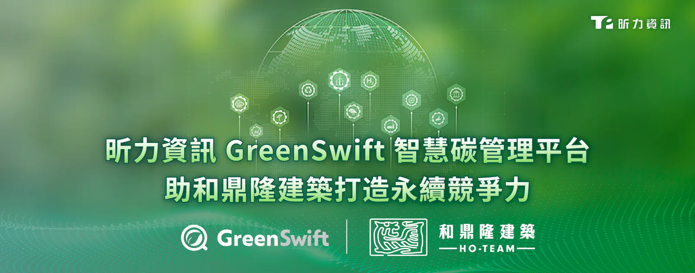

**[昕力資訊](/)**（7781）自主研發之 AI 智慧碳管理平台 **[GreenSwift](/products/greenswift)** 協助越南台商營造業龍頭「和鼎隆建築」進行數位化碳盤查，並產出符合國際標準的盤查報告書，讓組織可直接提交予第三方查驗機構進行認證，不僅簡化報告編撰作業、確保盤查數據一致性，更強化企業 ESG 永續競爭力。

和鼎隆於界定期間與範圍內所蒐集、彙整及分析之溫室氣體排放量亦取得全球測試、檢驗與驗證領導品牌「必維集團（Bureau Veritas, BV）」之認證，認可其碳盤查結果具備完整性與可靠性。

**突破營造業數據孤島：GreenSwift 助和鼎隆落實減碳行動**

昕力資訊 GreenSwift 自 2025 年起受和鼎隆建築採用，GreenSwift 在設計上遵循 ISO 14064-1:2018 國際標準，實現碳數據的高效彙整。該平台支援多語系切換與跨區雲端協作的優勢，更能無縫支持跨國企業的區域管理需求。

在數據彙整過程中，平台內建的「AI 小幫手」擔任即時顧問，自動比對並推薦最適用的國際碳排放係數，大幅降低出錯率。透過「AI 自動產出」功能，支援一鍵生成符合 ISO 14064 標準的繁中、英文及越南文的永續報告書與溫室氣體排放清冊。這套高度自動化的機制，不僅將原先耗時數月的盤查週期縮短，更助力和鼎隆公正且合理地呈現溫室氣體排放數據，為通過第三方查證奠定堅實基礎。

**深耕東南亞：助企業實現綠色數位轉型**

隨著全球供應鏈對淨零排放的要求提升，ESG 已成為越南企業的競爭力關鍵。然而根據 PwC 報告顯示，儘管 80% 的越南企業已作出 ESG 承諾，卻有高達 71% 的企業因缺乏對數據理解及報告要求，導致行動停滯。

和鼎隆副總經理簡子沄指出：「通過國際第三方機構的查證，是企業將永續承諾轉化為實質競爭力的關鍵里程碑。這次和鼎隆順利通過必維集團（BV）查證，驗證了我們碳數據的真實性與合規性。面對 2029 年越南即將全面啟動的碳交易市場，取得國際認可的『碳盤查身分證』，企業將在未來的綠色供應鏈與碳交易中搶得先機。」

昕力資訊總經理葉怡蘭表示：「昕力 GreenSwift 憑藉『跨區雲端協作』與『動態場域數據擷取』等核心優勢，成功克服了過去需要依賴人工作業、數據難以即時追蹤的困境。這份堅實的技術實力已深植海內外，不僅在台灣積極配合政府『數位與淨零雙軌轉型』政策，助攻製造業接軌國際減碳標準，更將這份深厚的技術底蘊轉化為東南亞台商應對綠色關稅的最強後盾。此次順利支持和鼎隆完成盤查，充分展現了 GreenSwift 作為數位化工具，協助跨國企業落實國際標準申報時的實戰價值。未來我們將持續深化區域佈局，並連結政府智慧化與低碳化轉型資源，引領百工百業在永續競賽中取得先機。」
