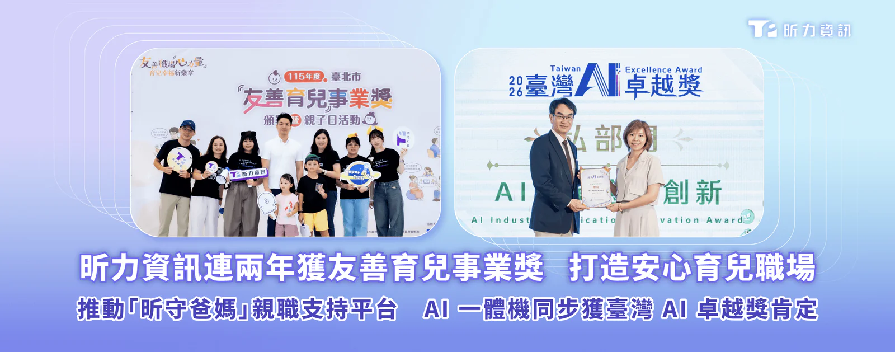
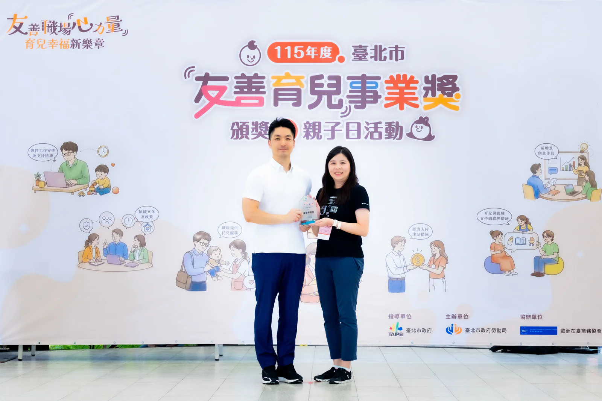
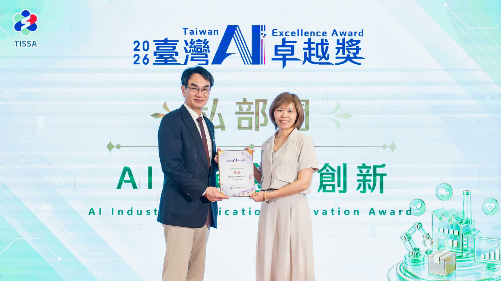

**[昕力資訊](/)**（7781）在推動 AI 創新與友善職場雙雙告捷。連續兩年榮獲「**[臺北市友善育兒事業獎](https://bola.gov.taipei/cp.aspx?n=E5C5E8BD24E3A36C)**」績優事業組肯定，透過彈性工作安排、育兒支持與子女教育補助，協助員工兼顧職涯與家庭，2025 年更推出「昕守爸媽」親職支持平台，結合線上教育講座與育兒物資交流，將家庭支持延伸至員工日常，持續打造安心工作、安心育兒的職場環境。另外，在首屆「**[2026 臺灣 AI 卓越獎](https://aiaward.tissa.tw/winner.html)**」中，昕力憑藉「AISO AI 一體機解決方案」榮獲「AI 產業應用創新」優品，展現前瞻技術與垂直整合能力。

**連續兩年 榮獲「臺北市友善育兒事業獎」**

昕力推動友善育兒成果連續兩年獲頒「臺北市友善育兒事業獎」，為本年度 42 家績優事業單位之一，亦是唯二獲獎的軟體公司，昕力致力打造幸福職場，持續推動全方位的家庭支持措施，從孕期、生產、托育到子女就學，皆提供完善的福利制度，包含：優於法規的產檢假、彈性工時、遠端辦公、親子祝福禮盒等，公司內亦設有哺集乳室與臨時托育空間，滿足員工家庭照顧需求。去年更首創「昕守爸媽」親職支持平台，除了定期舉辦線上教育講座，也讓員工能透過平台交換親子物品、兒童繪本等物資，實踐同仁間的互助精神與共享文化。此外，昕力也提供特約幼兒園註冊費九折優惠，針對國小至研究所子女亦每年發放補助，協助減輕學雜費負擔。

**昕力與 AISO 聯盟夥伴同獲 臺灣 AI 卓越獎**

今年首度舉辦「2026 臺灣 AI 卓越獎」，由中華民國資訊軟體服務商業同業公會評選出 48 項公、私部門優質標竿方案。昕力此次獲獎產品「AISO AI 一體機」以軟硬整合、整機交付為核心，內建昕力自研的 Agentic AI 治理平台—— **[OrientAI](/orient-ai)** 專用機，不僅實現高效推論運算，同時針對存取權限與 Token 用量進行統一控管，滿足跨部門、跨產業的 AI 應用需求，雲地混合架構兼具地端模式的隱私安全性與雲端的擴充彈性，企業可依團隊規模配置硬體，並有多種關鍵應用軟體供自由選配，大幅降低 AI 成本與導入門檻，使企業主權 AI 落地更符合成本效益；值得一提的是，AISO 聯盟夥伴​興創知能（ThinkTron）與走著瞧（Gogolook）亦在競賽中脫穎而出，與昕力同獲臺灣 AI 卓越獎肯定。

昕力資訊總經理葉怡蘭表示：「在 AI 轉型與永續發展並重的時代，昕力以科技賦能，對外提供 AI 軟硬體整合方案以驅動高效智慧營運，對內則推行多項員工支持計畫以打造多元共融文化，我們堅信『技術』與『人才』是驅動成長的兩大支柱，除了獲得 AI 卓越獎與友善育兒獎，我們的技術團隊在 2026 台灣聯測松亦表現傑出，以最高等級表現通過驗證，在建立醫療資訊互通性上具備實證技術能力，且能有效協助醫療院所接軌 SMART on FHIR 標準並推動智慧醫院落地。我們將持續帶領企業創新突破，迎向科技與永續並行的韌性未來。」

*台北市長蔣萬安（左）與昕力資訊副總經理葉淑婷（右）頒獎合照*

*數發部部長林宜敬（左）與昕力資訊總經理葉怡蘭（右）獲獎合影。圖／中華軟體公會提供*
